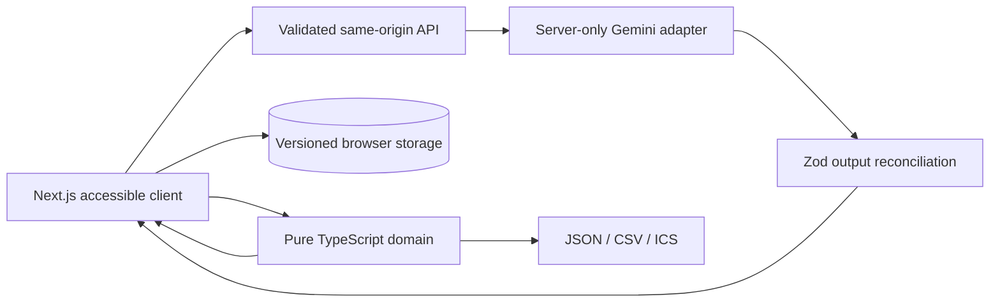

# Utsav architecture

The domain package owns event validation, budget allocation, readiness and schedule impact. It has no UI or external AI dependencies. Gemini is an optional recommendation provider; a deterministic local response is used without credentials or when the provider fails. Browser data is schema-versioned and locally stored. Only the compact context needed for an explicitly requested assistant response is sent to the server.

## Main request flow

1. The browser validates a request shape through the same-origin assistant route.
2. The route rejects oversized bodies, cross-origin requests and excessive per-process requests.
3. The server bounds user text and compact event context, excludes saved names and supplier labels, calls Gemini with a central system prompt, then validates structured JSON with Zod.
4. AI responses are displayed as advice; plan edits require an explicit user action. Financial arithmetic and readiness never call AI.

## Known boundaries

The in-memory rate limiter is per process and is not a distributed quota. For Cloud Run scale-out, replace it with a shared limiter and a durable daily quota. Offline mode covers local plans and deterministic advice but cannot call Gemini. This first release has a local event editor rather than the full multi-step intake workflow. Vendor shortlist slots are intentionally unnamed until the user supplies real vendors.
